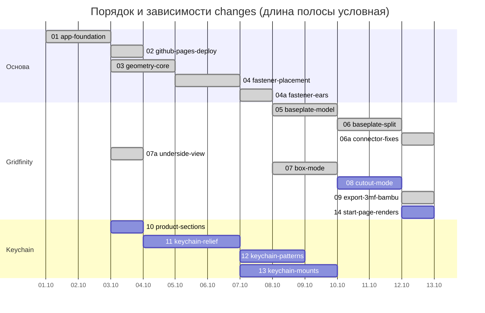

# Roadmap

Порядок работ = числовой префикс папки в `openspec/changes/`. Брать строго по возрастанию; зависимости указывают только на меньшие номера.

| # | Change | Depends on | Результат |
|---|--------|-----------|-----------|
| 01 | `01-app-foundation` | — | Tailwind, Tabler, структура компонентов, i18n en/ru, mm/inch, переключатель режимов |
| 02 | `02-github-pages-deploy` | 01 | CI и деплой на GitHub Pages (дальше каждая фича сразу видна онлайн) |
| 03 | `03-geometry-core` | 01 | Общая геометрия Gridfinity, дробные xy-юниты, настройки толщин |
| 04 | `04-fastener-placement` | 01, 03 | Винты и магниты: по краям, в каждой ячейке, вручную |
| 04a | `04a-fastener-ears` | 04 | Уши вокруг отверстий вместо сплошного пола, без ручной расстановки, правка подписей в tab |
| 05 | `05-baseplate-model` | 01, 03, 04 | Режим Baseplate на новой геометрии |
| 06 | `06-baseplate-split` | 05 | Разделение на части под стол, торцевые соединения |
| 06a | `06a-connector-fixes` | 06 | Ласточкин хвост на столе, отверстия под пруток филамента и глухие |
| 07 | `07-box-mode` | 01, 03, 04 | Box/Tray: wall, ledge, scoop |
| 07a | `07a-underside-view` | 01 | Камера проходит под плоскость XY, сетка и стол скрываются, подсветка снизу |
| 08 | `08-cutout-mode` | 07, 04 | Cutout: STL-импорт, прямоугольник, центровка |
| 08a | `08a-cutout-fixes` | 08 | Полупрозрачный вырезающий инструмент в превью, настоящее 3D с замыканием формы (вставляемый карман), замыкание сечений для незамкнутых STL |
| 09 | `09-export-3mf-bambu` | 05–08 | Экспорт 3MF, пресеты Bambu |
| 10 | `10-product-sections` | 01 | Разделы сайта Gridfinity Master / Keychain Master, маршруты, переключатель продуктов |
| 11 | `11-keychain-relief` | 10 | Keychain: растр → силуэт → рельеф, масштаб, подложка, STL |
| 12 | `12-keychain-patterns` | 11 | Keychain: источники высоты (в т.ч. яркость), профили, паттерны |
| 13 | `13-keychain-mounts` | 11 | Keychain: крепление под кольцо, редактор расстановки, две половинки, штифты |
| 14 | `14-start-page-renders` | 07, 08, 10 | Стартовая страница: векторные рендеры настоящих деталей 2×2 вместо схематичных SVG, готовятся на этапе сборки |
| 15 | `15-keychain-ui-polish` | 13 | Кнопки +/− у всех числовых полей, крупный просмотр маски, ровные и заметные оси в редакторе положения. Блокирует 16, 17, 18 |
| 16 | `16-keychain-shape-mode` | 13, 15 | Keychain делится на два режима как Gridfinity: 1 Изображение, 2 Форма (прямоугольник, круг, эллипс, капсула, многоугольник, скругление, бортик). У формы нет маски, порога, областей и яркости. Блокирует 19 |
| 17 | `17-keychain-smoothing` | 12, 15 | Сглаживание: яркости (шум фото, только режим Изображение) и поверхности рельефа, по радиусу в мм. Блокирует 18, 19 |
| 18 | `18-keychain-areas` | 11, 12, 15, 17 | Только режим Изображение: «дырки» → «области»: режим каждой области (по рельефу / открыта / свой уровень в мм), выбор по клику на маске |
| 19 | `19-keychain-text` | 11, 12, 13, 16, 17 | Надпись: выпуклая/вдавленная, ~24 популярных шрифта fontsource (латиница и кириллица), свой файл, положение в редакторе |
| 20 | `20-keychain-assembled-view` | 13 | 3D-просмотр двух половинок в собранном виде и с раздвижкой, без пересчёта геометрии. Ничего не блокирует |
| 21 | `21-collapsed-sections-previews` | 16, 17, 18, 19 | Все секции настроек свёрнуты по умолчанию, не дефолтное значение в заголовке секции подсвечено оранжевым; на главной у Gridfinity превью коробки, у Keychain свои сгенерированные рендеры |
| 22 | `22-keychain-art-paw` | 11, 14, 21 | Карточка Keychain на стартовой странице: лапа вместо диска со звездой, гладкие края (мелкая сетка и сглаживание масок трассировки) |
| 22a | `22a-printkit-branding` | 21, 22 | Название PrintKit, общий README и References, блок Motivation на главной, ссылка на GitHub в хедере, TRC20 в футере, Яндекс Метрика с баннером согласия |
| 23 | `23-cutout-circle` | 08 | Вырез «круг»: диаметр, глубина, зазор; в списке, виде сверху и 3D |
| 24 | `24-cutout-colors` | 08, 23 | Каждый вырез своего цвета (палитра из 7), один цвет в списке, виде сверху и 3D |
| 25 | `25-cutout-photo-trace` | 08, 11, 23, 24 | Вырез «Из фото»: снимок на листе бумаги → выравнивание по углам → силуэты по контрасту → вырезы по контуру в масштабе, корпус по минимальному числу юнитов |
| 25a | `25a-photo-trace-improvements` | 25 | Фото-вырезы: удобные углы как в сканере Apple (кольца, захват рядом с углом, лупа), автоопределение листа и формата, бумага на шаге углов, цвет и устойчивость к теням |
| 26 | `26-rack-panels` | 09, 10, 14 | Новый раздел Rack Master (10-дюймовая стойка): панели n U, стандартные отверстия в ушах, сквозные узоры (Skadis, hex, pills, lines, passthrough), задняя стенка отдельной деталью |
| 27 | `27-rack-panel-kumiko` | 26 | Узоры asanoha (гравировка) и Hicks hexagon для панелей |
| 28 | `28-rack-enclosures` | 26 | Корпуса под устройство: передняя панель с ушами и оболочка, окно, кистоуны, отверстия под кабель, вентиляция |
| 29 | `29-beta-label` | 22a | Метка beta и дисклеймер; версия 1.0.0 из package.json на фронтенде; правило semver: каждый change поднимает версию (config.yaml, CLAUDE.md, CHANGELOG.md) |
| 30 | `30-rack-front-plate` | 28, 29 | v1.1.0. Передняя панель корпуса: крепление keystone по моделям (гнездо с рампой и защёлкой, обойма за панелью), группы отверстий (колонка, ряд, сетка, зоны вокруг корпуса), «отверстия» вместо «кабельных», окно по умолчанию, ссылки на референсы в README |
| 31 | `31-rack-shelf` | 26, 29 | v1.2.0. Полка: передняя панель с ушами лицом на столе, пол с вентиляцией (щели, можно глухой), боковые стенки с прямым скосом, вентиляция передней панели опционально |
| 31a | `31a-status-log` | 29 | v1.3.0. Общий независимый лог приложения: статус-бар показывает лоадер и текущую строку, по клику открывается панель с полным логом (уровни, источники, фильтры, копирование); лог пишут генерация, импорт, хранилище, фото-диалог, экспорт |
| 32 | `32-photo-trace-ai` | 25a, 29, 31a | v1.4.0. Фото-вырезы: альтернативный нейросетевой движок силуэтов (в браузере, веса по согласию, гибридный точный край), классический остаётся по умолчанию как baseline; сравнение движков |
| 33 | `33-keychain-ai-silhouette` | 32, 11, 29 | v1.5.0. Keychain Image: силуэт по ИИ (удаление фона на браузерной модели), те же ручки порога и сглаживания, один главный объект, результат хранится вместе с картинкой; яркость остаётся по умолчанию |
| 34 | `34-keychain-photo-relief` | 33, 32, 12, 17, 29 | v1.6.0. Keychain Image: рельеф из фото как смесь трёх источников формы (контур, глубина Depth Anything, детали — локальный контраст), кроп области (лицо), силуэт «весь кадр» (плашка), пресеты; результат хранится с картинкой |
| 35 | `35-smooth-outline` | 25a, 29 | v1.7.0. Общий этап контура для вырезов (классика и ИИ) и Keychain: подгонка кубических кривых Безье с минимумом точек, острые углы сохраняются, зазор по кривой; стенки без ряби, детекция не меняется |

05–06 и 07–08 независимы друг от друга и могут идти в любом порядке.

10–13 — отдельная ветка (Keychain Master); 12 и 13 независимы друг от друга.
